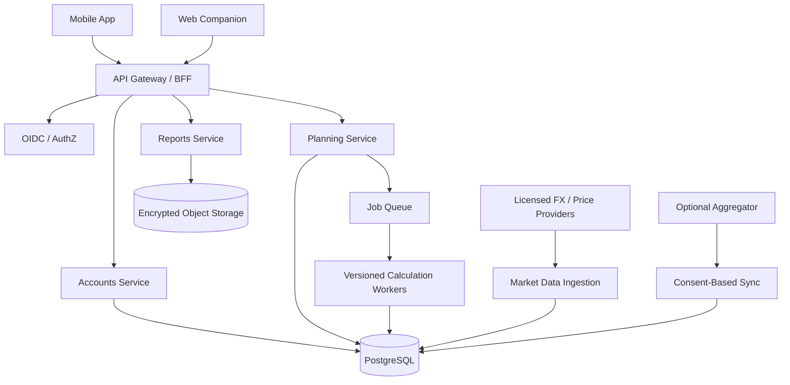

# WealthPilot — Cross-Border Financial Planning Platform

**Version:** 1.0 (implementation-ready product and technical specification)  
**Status:** Proposed; legal, tax, financial and regulatory assumptions require expert review before launch  
**Initial market:** US residents with financial ties to India (including NRIs, H-1B workers, permanent residents, dual-income households)  
**Platforms:** iOS, Android, responsive web companion  
**Positioning:** A scenario-first, explainable, privacy-conscious financial planning cockpit for two-country households.

---

## 1. Executive summary

WealthPilot helps people answer consequential cross-border questions without pretending that one static spreadsheet can model two financial systems. It aggregates or manually records US and Indian assets, liabilities, income, employer equity, retirement benefits, and goals; converts them to a transparent multi-currency household balance sheet; and compares auditable scenarios for home purchases, retirement, currency changes, and relocation.

**North-star promise:** “See what you own across borders, understand the assumptions, and compare what happens next.”

**Core differentiators:** (1) US–India-specific financial primitives, (2) time-aware RSU/401(k)/EPF modeling, (3) explicit tax residency and jurisdiction boundaries, (4) reproducible scenario engine, (5) no fabricated market prices or account balances, (6) clear distinction between deterministic calculations and uncertain forecasts.

**Not:** brokerage, tax-preparation software, remittance provider, investment adviser, or a replacement for a licensed tax or financial professional. Never promise guaranteed returns, tax eligibility, or legal compliance.

### 1.1 Primary jobs to be done

1. “What is my household net worth across USD and INR, and how much of it is actually liquid?”
2. “Can I buy a $1.3M home in 3–5 years without jeopardizing retirement?”
3. “How will quarterly RSU vesting and withholding affect my down-payment timeline?”
4. “If I stay in the US versus return to India, how do retirement and cash flows differ?”
5. “How much exposure do I have to employer stock, INR, real estate, and illiquid accounts?”
6. “What assumptions drive the outcome, and which should I verify with a professional?”

### 1.2 Target users

- **Primary:** US-based Indian-origin professionals with 401(k), employer RSUs, Indian EPF/PPF/FD/mutual funds, and goals in either country.
- **Secondary:** US–India households nearing retirement, returning NRIs, people with dependents or multi-country liabilities.
- **Later:** Independent fiduciary planners serving cross-border households via a consent-based advisor workspace.

### 1.3 Product principles

- **Clarity over precision theater:** ranges, timestamps, confidence, and sensitivity analysis.
- **Privacy by default:** manual entry works; no financial connections required.
- **Traceability:** every figure links to inputs, formulas, and rate/tax-rule versions.
- **No silent tax assumptions:** residency, account treatment, and jurisdiction-specific rules are explicit.
- **Household ownership:** spouse/partner sharing is opt-in and permissioned.
- **Portable:** exports in CSV/JSON/PDF and ability to delete all user data.

---

## 2. Scope and release plan

### 2.1 MVP (release 1)

- Email/passkey login, MFA option, onboarding and household setup.
- Manual accounts and assets in USD/INR, liabilities, transaction-free balance snapshots.
- FX conversion with timestamped sourced rates and configurable stress assumptions.
- US 401(k), traditional/Roth IRA as generic account types; configurable contribution, match, growth, withdrawal assumptions.
- RSU grants, vest schedules, share counts, vest-day fair value, sell/hold decisions, and **illustrative** tax-withholding/cash-flow treatment.
- Indian EPF as a manual balance with editable accrual and withdrawal assumptions; no automatic eligibility determinations.
- India FDs, mutual funds, cash, real estate as manual holdings.
- US home-affordability and down-payment planner including principal, interest, taxes, insurance, HOA, PMI, closing costs and maintenance.
- Retirement scenario engine with US/India living expenses and selectable inflation, returns, FX, and withdrawal assumptions.
- Scenario comparison (baseline, conservative, optimistic, custom), charts, assumption audit trail, shareable read-only PDF.
- Disclaimers, stale-data banners, accessibility, telemetry and secure export/deletion.

### 2.2 Post-MVP (release 2)

- Consent-based US account aggregation via approved provider; connection health and reconciliation.
- Statement CSV/PDF import with user-confirmed parsing (never silently ingest ambiguous values).
- India account connectors **only** after legal/technical validation; otherwise CSV/manual.
- Employer-stock concentration analytics and vest-calendar notifications.
- Monte Carlo retirement simulations and historical stress tests with clear limitations.
- Household collaboration and beneficiary/document checklist (no storage of raw identity documents by default).
- Advisor review workspace with revocable access and immutable change history.

### 2.3 Later (release 3+)

- Tax-aware scenario estimates with expert-reviewed rule packs by tax year and residency category.
- Cross-border relocation checklist and configurable Social Security/pension assumptions.
- Goal optimization and savings allocation suggestions subject to regulatory review.
- Additional corridors: US–Canada, UK–India, UAE–India (separate rule packs).

### 2.4 Explicit exclusions

No securities trading, transfers/remittances, tax filing, loan origination, guaranteed investment recommendations, automated EPF withdrawals, bank credential scraping, or unauthorized LinkedIn/employer integrations. No claim that Indian EPF is immediately accessible or that RSU grant value equals cash.

---

## 3. Personas and critical user journeys

### Persona A: Equity-heavy technology professional

US salary + annual bonus + quarterly RSUs, 401(k), Indian savings, planning a US house. Needs to distinguish vested/unvested equity and estimate net proceeds under sell-at-vest assumptions.

### Persona B: Returning NRI

Owns Indian FDs and US retirement accounts; considering relocation within five years. Needs scenario comparisons under editable taxes, FX, cost-of-living, healthcare and withdrawal assumptions.

### Persona C: Dual-income family

Two earners, different currencies, education and retirement goals; needs consolidated balance sheet without exposing every account to the other partner.

### Journey J1: First value in 8 minutes

1. Choose residency and currencies; confirm no tax advice.
2. Add salary, savings, retirement and RSUs through guided templates.
3. Enter Indian holdings and debts; mark estimated versus verified balances.
4. See consolidated balance sheet and currency exposure.
5. Create first goal and compare two scenarios.

### Journey J2: Home purchase decision

1. Set location, target price, desired purchase date, down payment and rate.
2. Add property tax, insurance, HOA, maintenance, closing costs and reserve floor.
3. Identify eligible liquid sources; exclude unvested RSUs and inaccessible retirement funds by default.
4. Model salary savings, net RSU proceeds, and FX transfer timing with user-defined transfer costs.
5. Show month-by-month down-payment funding, estimated all-in housing cost, and downside sensitivity.
6. Present gaps and assumption warnings; no mortgage approval claims.

### Journey J3: Retirement geography

1. Pick retirement age, longevity, US versus India location, current balances and income streams.
2. Define spending, healthcare, inflation, taxes and FX paths separately.
3. Compare projected cash flows and ending balances by age.
4. Highlight years with deficits, concentration risk, and rule uncertainties.
5. Export assumptions and outputs for professional review.

---

## 4. Information architecture and navigation

Bottom tabs: **Overview**, **Accounts**, **Plan**, **Insights**, **Profile**.

- **Overview:** total net worth, liquid net worth, US/India split, currency exposure, upcoming vests, goal progress, data freshness.
- **Accounts:** grouped by household member, country, account class; account detail and valuation history.
- **Plan:** goals, scenario library, assumption editor, compare, retirement and housing modules.
- **Insights:** concentration, FX exposure, upcoming events, sensitivity drivers, warnings.
- **Profile:** residency assumptions, household permissions, data sources, subscriptions, security, export/delete.

### 4.1 Screen inventory (MVP)

S01 Welcome; S02 Sign up/sign in; S03 Onboarding residency; S04 Household setup; S05 Add asset/account; S06 Overview; S07 Account list; S08 Account detail; S09 RSU grant editor; S10 Vest calendar; S11 EPF editor; S12 FX assumptions; S13 Goal list; S14 Home planner; S15 Retirement planner; S16 Scenario editor; S17 Comparison charts; S18 Explain calculation; S19 Insights; S20 Notifications; S21 Data export; S22 Privacy/security; S23 Subscription; S24 Help and disclosures.

### 4.2 UX behavior

- Display **USD $** and **INR ₹** with locale-aware formatting; never confuse lakh/crore notation with numeric precision.
- Toggle reporting currency without mutating underlying balances.
- Every forecast card has `As of`, `Scenario`, `Assumptions`, and `Illustrative` labels.
- Unverified and stale figures are visually distinct from confirmed figures.
- Support light/dark themes, Dynamic Type, VoiceOver/TalkBack, WCAG 2.2 AA targets.
- Empty states guide manual setup; offline cache is read-only until safe synchronization is available.
- Currency conversion displays FX source, rate date, and whether fees/spread are included.

---

## 5. Functional requirements

Each requirement has an identifier for implementation and test traceability.

### 5.1 Identity and household

- **FR-ID-001:** Email verification and passkeys; optional TOTP MFA, backup recovery flow.
- **FR-ID-002:** User chooses home country, reporting currency, assumed tax residency and effective dates.
- **FR-ID-003:** Household members have owner/editor/viewer permissions; private accounts remain hidden unless shared.
- **FR-ID-004:** Account deletion revokes sessions, disconnects providers and queues verified data erasure within published retention policy.
- **FR-ID-005:** Sessions, critical settings changes and exports recorded in security audit log.

### 5.2 Assets, debts, and valuation

- **FR-AS-001:** Support cash, checking, savings, brokerage, retirement, RSUs, EPF, PPF, FD, mutual funds, real estate, loans and custom assets.
- **FR-AS-002:** Store native currency, valuation amount, timestamp, source and verification state.
- **FR-AS-003:** Distinguish account balance, vested holdings, unvested awards, and projected future contributions.
- **FR-AS-004:** Distinguish gross net worth, liquid net worth, and goal-eligible funds.
- **FR-AS-005:** Prevent double counting (e.g., vested RSU shares already held in brokerage; cash transferred between accounts).
- **FR-AS-006:** Historical snapshots are append-only and corrections are traceable.
- **FR-AS-007:** Support user-defined ownership percentages and joint ownership.

### 5.3 RSUs

- **FR-RSU-001:** Grants include employer identifier, grant date, quantity, vest events, award currency, and optional grant-date reference price.
- **FR-RSU-002:** Track scheduled, vested, withheld/sold-to-cover, sold and held shares separately.
- **FR-RSU-003:** Model vest-day ordinary income and subsequent price changes separately, with configurable assumptions and tax caveats.
- **FR-RSU-004:** Never treat unvested equity as current liquid assets.
- **FR-RSU-005:** Forecast net cash under hold, sell-on-vest, sell-fraction, and manual disposition strategies.
- **FR-RSU-006:** Detect and flag missing prices, split adjustments and duplicate vest imports.

### 5.4 Retirement and Indian assets

- **FR-RET-001:** 401(k) supports employee contribution, employer match formula, annual limits as versioned configurable inputs, salary growth and return assumptions.
- **FR-RET-002:** Pre-tax and Roth balances/contributions are distinct; do not merge tax treatments.
- **FR-RET-003:** Model account access/penalties as editable constraints, not blanket withdrawal eligibility claims.
- **FR-RET-004:** EPF supports employee/employer components when known, opening balance, credited interest, contributions, and manual accessibility state.
- **FR-RET-005:** EPF withdrawal/taxability is never asserted from account age alone; request professional verification.
- **FR-RET-006:** Indian FD maturity, interest accrual and taxes are scenario inputs, not assumed universally.
- **FR-RET-007:** Social Security estimates must be user-entered or based on an explicitly documented estimator; show credits and benefit eligibility as unverified until sourced.

### 5.5 Home planner

- **FR-HOME-001:** Compute monthly P&I from price, down payment, loan term and nominal annual interest rate.
- **FR-HOME-002:** Include property tax, homeowners insurance, HOA, PMI when applicable, maintenance, and utilities as separately configurable costs.
- **FR-HOME-003:** Model closing costs, emergency reserves, other debt obligations and target purchase date.
- **FR-HOME-004:** Compare required cash against liquid goal-eligible funding; no double-counting retirement assets or unvested equity.
- **FR-HOME-005:** Stress rate +/− 1–2 percentage points, purchase price, RSU price, FX and savings changes.
- **FR-HOME-006:** Display total housing payment separately from principal-and-interest payment.

### 5.6 Scenario engine

- **FR-SCN-001:** Create, clone, rename, version and archive scenarios.
- **FR-SCN-002:** Every run pins input snapshot, model version, rate snapshot and ruleset version.
- **FR-SCN-003:** Compare up to four scenarios across net worth, liquid assets, goal attainment, retirement deficits and concentration.
- **FR-SCN-004:** Return explainable yearly/monthly cash flows and sensitivities.
- **FR-SCN-005:** Calculation runs are deterministic for fixed inputs and seeded stochastic simulations.
- **FR-SCN-006:** Negative balances, insolvency, zero returns, rate changes, and missing inputs handled explicitly.

### 5.7 Notifications and exports

- **FR-NOT-001:** Opt-in vest reminders, stale balance alerts, goal milestones and expiring account connections.
- **FR-NOT-002:** No sensitive dollar amounts in push notification bodies by default.
- **FR-EXP-001:** Export balances and assumptions to CSV/JSON and formatted scenario reports to PDF.
- **FR-EXP-002:** Report includes generated date, FX rate source/date, data freshness, disclaimers, scenario ID and methodology version.

---

## 6. Calculation engine and formulas

**Rule:** calculations are server-authoritative; the mobile app may preview simple values but must reconcile with the backend. Use decimal arithmetic for money and documented rounding at display/export boundaries. Store fractional shares at suitable precision.

### 6.1 Net worth and FX

`NetWorth(reporting_currency, t) = Σ eligible_asset_values_native(t) × FX(native→reporting, t) − Σ liability_values_native(t) × FX(native→reporting, t)`.

- Maintain both current market-value view and scenario-projected view.
- `LiquidNetWorth` excludes inaccessible/restricted accounts, illiquid property, and unvested awards; users can override accessibility with an audit note.
- FX source must be licensed for intended commercial use; fallback rates are clearly marked stale and never silently used in new decisions.
- Model `INR_per_USD(t)` path explicitly; distinguish appreciation/depreciation and transfer spread.

### 6.2 Mortgage

For principal `P`, monthly interest `r = APR/12`, number of payments `n`:

`Payment = P × r × (1+r)^n / ((1+r)^n − 1)`; if `r=0`, `Payment=P/n`.

`AllInMonthly = Payment + property_tax/12 + insurance/12 + HOA + PMI + maintenance/12 + utilities`.

Cash-to-close = down payment + closing costs + prepaid costs − verified credits. Emergency reserve is a separate required balance, not a closing expense.

### 6.3 Savings projection

Monthly step simulation with opening balance, contributions, growth, withdrawals, taxes/fees and closing balance. Define timing convention (start/end of month) and test it. Inflation-adjusted results use consistent nominal or real return assumptions, never both simultaneously.

### 6.4 RSU vest event

`GrossVestValue = vested_shares × fair_market_value_on_vest_date`.

`EstimatedWithholding = GrossVestValue × configurable_withholding_rate` **for cash-flow illustration only**; actual payroll withholding, income tax liability, state taxation, share settlement and capital gains are separate concepts.

`NetSaleProceeds = sold_shares × sale_price − transaction_costs − user-configured estimated incremental taxes`.

Avoid subtracting withholding twice when sold-to-cover shares are already removed. Maintain event-level reconciliation and warnings for under-withholding.

### 6.5 EPF/FD

Use per-period accrual based on user-selected convention, contribution schedule and rate effective dates. Actual EPF crediting and Indian taxation may differ; preserve editable rates and disclosures. FD compounding frequency and TDS assumptions are explicitly set per deposit.

### 6.6 Retirement

`ClosingPortfolio(t) = OpeningPortfolio(t) × (1 + period_return) + contributions(t) − withdrawals(t) − fees(t) − estimated_taxes(t)` under stated timing convention.

Separate US and India spending, healthcare, inflation, account withdrawal order, taxes, and FX. Show nominal and real purchasing power. Never claim a fixed safe withdrawal rate is universally appropriate.

### 6.7 Uncertainty and sensitivity

MVP: deterministic baseline, downside, upside and one-variable sensitivity tables. Later: seeded Monte Carlo using explicit return distribution, volatility, correlations, sequence-of-returns risk, and reproducible seeds. Clearly state simulations are not probabilities of real-world success unless model assumptions justify interpretation.

### 6.8 Financial correctness test vectors

- Zero-rate mortgage: $300,000 / 360 = $833.33 monthly P&I.
- $1,000,000 home, 20% down: principal $800,000, not $1,000,000.
- USD 100 × 85 INR/USD = INR 8,500; reverse conversion returns USD 100 before fees/rounding.
- Unvested $100,000 grant adds $0 to liquid net worth.
- RSU 100 shares vest, 30 sold to cover, 70 held: current vested holdings 70; do not add all 100 shares to brokerage as well.
- Negative liability balances and inconsistent ownership must trigger validation rather than silently change sign.

---

## 7. Data model

Use PostgreSQL 16+ with UUID primary keys, tenant/household scope, `created_at`, `updated_at`, optimistic version, and soft-delete where appropriate. Monetary amounts: `NUMERIC(24,8)` and ISO 4217 currency; no floating point for ledger values. Encrypt sensitive fields at application layer when warranted.

### 7.1 Entities

| Entity | Essential fields |
|---|---|
| User | id, email, auth_subject, locale, timezone, reporting_currency, status |
| Household | id, display_name, default_currency, owner_user_id |
| Membership | household_id, user_id, role, status, invited_at |
| TaxResidencyPeriod | user_id, jurisdiction, residency_type, from_date, to_date, verified_by_user |
| Account | id, household_id, owner_id, country, type, institution_alias, currency, accessibility, connection_id |
| Holding | id, account_id, asset_type, symbol_or_identifier, quantity, cost_basis, currency |
| Valuation | id, holding_or_account_id, amount, as_of, source, verification_status |
| Liability | id, household_id, type, principal, rate, payment, currency, owner_id |
| RSUGrant | id, employer_alias, grant_date, granted_shares, award_currency, status |
| RSUVest | id, grant_id, vest_date, scheduled_shares, vested_shares, vest_fmv, withholding_shares |
| RSUDisposition | id, vest_id, date, shares, price, fees, tax_assumption_id |
| EPFAccountDetail | account_id, employee_component, employer_component, interest_assumptions, access_status |
| FixedDeposit | id, account_id, principal, start_date, maturity_date, interest_rate, compounding_frequency |
| FXRate | base_currency, quote_currency, rate, as_of, provider, license_reference |
| PriceQuote | instrument_id, price, currency, as_of, provider, quality |
| Goal | id, household_id, type, target_date, target_amount, currency, priority |
| Scenario | id, household_id, name, goal_id, parent_id, active_version |
| ScenarioVersion | id, scenario_id, input_snapshot_json, model_version, rulepack_version, created_by |
| SimulationRun | id, scenario_version_id, seed, status, started_at, completed_at, result_uri, checksum |
| ProjectionPoint | run_id, period, metric, value, currency, dimensions_json |
| RulePack | id, jurisdiction, tax_year, effective_date, reviewer, status, checksum |
| DataConnection | id, household_id, provider, status, last_synced_at, consent_expiry |
| Consent | id, user_id, provider, scopes, granted_at, revoked_at |
| NotificationPreference | user_id, type, channel, enabled |
| AuditEvent | id, actor_id, household_id, action, entity_ref, timestamp, metadata_redacted |
| ExportJob | id, user_id, format, status, expires_at, artifact_ref |
| Subscription | id, household_id, provider, entitlement, renewal_status |

### 7.2 Important constraints

- Account/holding uniqueness for provider IDs, with household-scoped deduplication.
- Vest event uniqueness `(grant_id, vest_date, source_event_id)` where source IDs exist.
- Check quantities nonnegative; rate/date ranges valid; ownership percentages between 0 and 100.
- Scenario versions immutable after creation.
- Derived totals are materialized caches, never canonical source records.
- Financial history uses immutable events/snapshots; correction via superseding records.
- Enforce row-level tenant isolation plus authorization in application services.

### 7.3 Suggested indexes

`(household_id, updated_at)` on accounts, `(account_id, as_of DESC)` on valuations, `(grant_id, vest_date)` on vests, `(scenario_id, created_at DESC)` on scenario versions, `(household_id, status)` on simulation runs, and `(user_id, timestamp DESC)` on audit events.

---

## 8. Architecture

### 8.1 Recommended stack

- **Mobile:** React Native + Expo + TypeScript, Expo Router, TanStack Query, Zustand for ephemeral UI, React Hook Form + Zod, Victory Native or equivalent accessible charting.
- **Web companion:** Next.js + TypeScript; share domain types and validation packages.
- **Backend:** Python 3.12+ FastAPI, Pydantic v2, SQLAlchemy 2, Alembic.
- **Database:** managed PostgreSQL; Redis for job coordination and rate limits (not source of truth).
- **Async jobs:** Celery/RQ or managed queue with idempotent workers.
- **Object storage:** encrypted S3/GCS for time-limited exports and optional statement uploads.
- **Auth:** standards-based OIDC provider supporting passkeys/MFA; do not implement password crypto from scratch.
- **Infra:** Terraform, managed container runtime, secrets manager, KMS, CI/CD.
- **Observability:** OpenTelemetry traces, metrics, structured redacted logs, error reporting.
- **Payments:** App Store/Play billing for in-app digital subscriptions as applicable; web billing compliant with platform policies.

### 8.2 Logical components



### 8.3 Service boundaries

Start as a **modular monolith** with modules: identity, household, accounts, equity, market data, rules, planning, reports, billing, notifications. Avoid premature microservices. Calculation core should be a pure, separately testable Python package, with stable input/output schemas and no database calls inside formulas.

### 8.4 Data flow

1. User edits a balance or scenario input; API validates authorization and schema.
2. Canonical record is written transactionally with audit event.
3. A new immutable scenario version captures input snapshot and rulepack versions.
4. Worker executes deterministic calculations and writes checksum-tagged results.
5. Client renders charts with freshness and uncertainty labels.
6. Exports reference exactly the same run ID; never silently recompute with newer FX.

### 8.5 Failure handling

- FX feed unavailable: show cached timestamp; block unsupported fresh conversion or require explicit stale-rate consent.
- Aggregator disconnected: preserve last verified snapshot with stale banner; no inferred updates.
- Job timeout: retry with exponential backoff, idempotency key and dead-letter queue.
- Partial imports: stage data, show reconciliation, commit only on user confirmation.
- Conflicting offline edits: detect version mismatch; present resolution rather than last-write-wins for financial records.

---

## 9. REST API specification

Prefix `/v1`; OAuth/OIDC bearer auth; tenant scope inferred from verified membership, never trusted from a client-provided ID alone. RFC 7807-style problem responses, request IDs, pagination, idempotency keys on mutations.

| Method | Endpoint | Purpose |
|---|---|---|
| GET | `/me` | User profile and entitlements |
| POST | `/households` | Create household |
| GET | `/households/{id}` | Household detail |
| POST | `/households/{id}/invites` | Invite member |
| GET | `/accounts` | List visible accounts |
| POST | `/accounts` | Create manual account |
| GET/PATCH | `/accounts/{id}` | Detail/update |
| POST | `/accounts/{id}/valuations` | Append valuation |
| GET | `/net-worth?as_of=...&currency=USD` | Net worth with breakdown and provenance |
| POST | `/rsu/grants` | Create grant |
| POST | `/rsu/grants/{id}/vests` | Add vest event |
| POST | `/rsu/vests/{id}/dispositions` | Record sale/withholding |
| GET | `/rsu/calendar` | Vest timeline |
| GET | `/fx/rates?base=USD&quote=INR` | Rate and provenance |
| POST | `/goals` | Create goal |
| POST | `/scenarios` | Create scenario |
| POST | `/scenarios/{id}/versions` | Immutable assumption version |
| POST | `/scenario-versions/{id}/runs` | Queue calculation |
| GET | `/runs/{id}` | Run status/metadata |
| GET | `/runs/{id}/results` | Projection and warnings |
| POST | `/comparisons` | Compare run IDs |
| POST | `/exports` | Request export |
| GET | `/exports/{id}` | Export status and short-lived URL |
| POST | `/connections` | Begin aggregator consent flow |
| DELETE | `/connections/{id}` | Revoke connection |
| GET/PATCH | `/notification-preferences` | User preferences |
| POST | `/privacy/delete-request` | Request account deletion |

### 9.1 Example: create scenario version

```json
{
  "scenario_id": "uuid",
  "base_date": "2026-10-01",
  "reporting_currency": "USD",
  "assumptions": {
    "salary_growth_annual": "0.02",
    "portfolio_return_nominal_annual": "0.06",
    "us_inflation_annual": "0.025",
    "india_inflation_annual": "0.05",
    "usd_inr_start": "85.00",
    "inr_depreciation_annual": "0.02",
    "retirement_age": 65
  },
  "goal_overrides": {},
  "notes": "Illustrative user assumptions, not current market facts"
}
```

### 9.2 Example: run result

```json
{
  "run_id": "uuid",
  "status": "completed",
  "model_version": "1.0.0",
  "currency": "USD",
  "as_of": "2026-10-01",
  "metrics": {
    "liquid_net_worth": "145000.00",
    "projected_goal_gap": "35000.00"
  },
  "warnings": [
    {"code": "UNVESTED_EQUITY_EXCLUDED", "severity": "info"},
    {"code": "EPF_ACCESS_UNVERIFIED", "severity": "warning"}
  ],
  "assumption_snapshot_hash": "sha256:...",
  "projections": []
}
```

### 9.3 API conventions

- Monetary values serialized as decimal strings.
- Date-only events use ISO date and declared timezone; vesting dates are not interpreted as UTC timestamps.
- PII and account identifiers never appear in analytics events or error payloads.
- 401/403/404 distinctions avoid leaking household resource existence.
- Pagination and cursor ordering stable; API OpenAPI spec generated and contract-tested.

---

## 10. AI features (bounded, optional, explainable)

### 10.1 AI planning copilot (post-MVP or limited beta)

Natural language interface: “What happens if I buy a $1.2M home in 2029 and my RSUs fall 30%?”

**Required pipeline:** intent parser → structured proposed scenario delta → schema validation → user confirmation → deterministic calculation tool → grounded explanation → citations to internal inputs/formulas. LLM must **never** invent balances, prices, laws, or simulation outputs.

### 10.2 AI statement extraction

Opt-in uploaded documents → secure parser/OCR → extracted fields with confidence and page references → user verification → canonical account update. Treat all document text as untrusted prompt-injection surface; do not execute instructions from statements.

### 10.3 AI insights

Examples: “Your projected down payment depends on unvested employer equity” or “A 10% INR move changes your reported Indian assets by approximately X.” Every insight is based on a deterministic computed fact, with linked inputs.

### 10.4 AI safeguards

- Explicit consent for third-party model processing; disclose provider, retention and geographic processing.
- PII minimization, data redaction, no training on customer financial data without explicit opt-in.
- Tool allowlists, read-only model access by default, per-user cost limits and abuse controls.
- Human review and compliance signoff for financial guidance prompts.
- Eval sets for arithmetic grounding, hallucination, tax-law uncertainty, privacy leakage, prompt injection and unsafe advice.

---

## 11. Security, privacy, and compliance

**This section is a design requirement, not a legal opinion. Engage US and India counsel and qualified tax professionals before release.**

### 11.1 Threat model

Assets: account balances, income, equity schedules, household membership, tax residency, statements, export files, access tokens. Threats: account takeover, cross-tenant data leakage, malicious imported documents, insider access, stolen mobile devices, credential/token theft, compromised providers, unauthorized exports, inference from notifications.

### 11.2 Controls

- TLS 1.2+ (prefer TLS 1.3); AES-256-equivalent encryption at rest with managed keys.
- Device secrets in iOS Keychain / Android Keystore; never plaintext local credentials.
- Short-lived tokens, rotation, revocation, MFA for sensitive actions.
- Authorization tested for every resource; object-level access control and household scope.
- Principle of least privilege, separate environments, production access approvals, audit trails.
- Rate limits, WAF, dependency and container scanning, signed builds, SBOM, secret scanning.
- Database backup encryption, tested restore, defined RPO/RTO and incident-response runbooks.
- Export URLs short-lived and access-controlled; optional device biometric unlock.
- Retention schedule, data subject rights workflows, vendor DPA reviews, deletion verification.
- No raw financial login credentials; use approved tokenized account-linking providers only.

### 11.3 Regulatory review checklist

- US investment-adviser/financial-planning boundaries and state/federal registration triggers.
- Financial-data privacy, consumer protection, data security, breach notification, applicable state privacy laws.
- Gramm-Leach-Bliley applicability based on actual business model and partners; do not assume automatic coverage/exemption.
- CFPB personal financial data rights/open banking implementation and litigation status at launch; provider contract requirements.
- India DPDP Act/rules effective dates, cross-border processing, consent and grievance obligations as applicable.
- RBI rules and account-aggregator eligibility if pursuing Indian financial-data integrations.
- FEMA/foreign exchange, remittance, tax residency, US/India tax treaties, foreign asset reporting and EPF treatment: present only reviewed content, never legal determinations.
- Apple/Google subscription and financial-services app rules.

### 11.4 Compliance content lifecycle

Every legal/tax rule has jurisdiction, effective date, tax year, primary-source link, author/reviewer, last reviewed date, applicability and expiry. Unreviewed rules are disabled; out-of-date rule packs trigger warnings or block regulated outputs. Maintain a content correction process.

---

## 12. Monetization and packaging

**Free:** 5 accounts, manual tracking, basic net worth, one goal, one scenario, standard exports with watermark.

**Plus ($7.99/month or $69/year, proposed):** unlimited accounts, RSU/EPF modules, unlimited goals, up to 10 saved scenarios, detailed reports, reminders.

**Pro ($14.99/month or $129/year, proposed):** unlimited scenario comparisons, advanced retirement/housing stress tests, AI copilot usage allowance, household sharing, expanded exports.

**Advisor (future, pricing TBD):** multi-client consent workspace, audit logs, report templates, advisor notes and role controls.

Prices are hypotheses requiring willingness-to-pay testing. No affiliate recommendations or product placement that could compromise user trust without prominent disclosure. Never sell identifiable financial data.

---

## 13. Analytics and success metrics

### 13.1 North-star metric

**Monthly active planning households:** households that complete a meaningful scenario run or update a goal in the last 30 days.

### 13.2 Activation funnel

Sign-up → residency/currency setup → first 3 accounts → first complete net-worth view → first goal → first scenario comparison → export/share.

### 13.3 Targets (hypotheses, validate with pilot)

- ≥50% of onboarded users create 3+ accounts in 7 days.
- ≥30% create first scenario in 7 days.
- ≥25% 30-day retention for activated households.
- ≥99.9% calculation correctness against golden vectors.
- 0 critical cross-tenant authorization defects.
- P95 overview API under 500 ms for cached data; P95 deterministic scenario run under 5 s for standard 50-year monthly projection.

Telemetry uses anonymous event IDs and coarse metadata only; never emit salary, balances, exact asset values or identity documents.

---

## 14. Delivery roadmap

### Phase 0 — Discovery and compliance (weeks 1–2)

20–30 customer interviews; validate top three jobs and pricing; financial-domain expert review; data-provider feasibility; clickable prototype; privacy architecture and threat model.

### Phase 1 — Foundation (weeks 3–4)

Repo/CI/CD, auth, household permissions, database migrations, design system, audit logging, manual accounts, FX provenance and initial overview.

### Phase 2 — Domain models (weeks 5–7)

RSU vest scheduler, 401(k)/EPF/FD modules, valuation history, double-counting protections, calculation library with golden tests.

### Phase 3 — Planning (weeks 8–10)

Home planner, retirement engine, immutable scenarios, compare charts, explain-calculation panels, exports.

### Phase 4 — Hardening and beta (weeks 11–12)

Accessibility, performance, privacy testing, penetration test, backup restore drill, app store compliance, 50–100-person closed beta and instrumentation.

**Staffing assumption:** 1 strong full-stack architect/developer + part-time mobile designer + independent security and tax/financial reviewers. A single developer can prototype in 12 weeks; a production-grade regulated-adjacent launch may require more time and external review.

### 14.1 Milestones / exit gates

- M1: all core account types represented, no cross-tenant access.
- M2: net worth reconciles to hand-calculated test fixture.
- M3: RSU/retirement/housing scenario results reproduce identically.
- M4: PDF export matches on-screen run, inputs and warnings.
- M5: security/privacy/compliance signoff and beta feedback triage.

---

## 15. Testing strategy

- **Unit:** money math, FX direction, compounding, mortgages, vest rounding, vest/sale reconciliation, inflation, retirement cash flows.
- **Property-based:** currency round trips within rounding tolerance, net-worth invariants, conservation of share quantities, no negative share ownership.
- **Contract:** OpenAPI schema, client generation, validation errors, idempotency.
- **Integration:** database migrations, tenant isolation, job retry, rate feed outage, export generation.
- **E2E:** onboarding, add accounts, RSU schedule, home scenario, compare, export, delete account.
- **Security:** OWASP ASVS/MASVS-aligned controls, IDOR, SSRF, injection, rate limiting, session revocation, dependency scanning.
- **Accessibility:** VoiceOver/TalkBack, contrast, keyboard/switch navigation, dynamic text and chart alternatives.
- **Financial QA:** expert-reviewed golden workbooks, boundary dates, changing annual limits, FX inversions, tax withholding versus liability distinctions.
- **Chaos/reliability:** job duplicates, stale FX, broken connector, backup restore, partial import and offline edits.

### 15.1 Acceptance scenarios

**AC-001:** User adds USD cash $10,000 and INR FD ₹850,000 with explicit 85 INR/USD; overview reports USD $20,000 gross assets, excluding any liabilities.

**AC-002:** A $100,000 unvested RSU award does not increase current liquid net worth; future scenario may include vest proceeds only under assumptions.

**AC-003:** Mortgage result separates P&I and property taxes/insurance/HOA; modifying HOA changes all-in cost but not P&I.

**AC-004:** User without access to a household account receives 404/403 with no sensitive data.

**AC-005:** Running identical scenario version/model/rate snapshots twice produces identical result checksum.

**AC-006:** Report includes all assumptions and explicit warning for unverified EPF withdrawal accessibility.

**AC-007:** Disconnected data source remains visible as stale, not zeroed or silently updated.

**AC-008:** Deletion request revokes active sessions and scheduled notifications, then follows published data-erasure workflow.

---

## 16. Sample seed data (fictional, for testing only)

Use a synthetic technology professional household, not actual user data:

- Age 41, US salary $270,000, bonus $40,000, annual RSU target $100,000.
- 401(k) balance $75,000, employee contribution $24,000/year, employer match configurable.
- Indian EPF ₹3,500,000, FD ₹2,000,000, US cash $60,000.
- Home goal $1,300,000 in four years with 20% down and emergency reserve $40,000.
- Scenarios: baseline, employer stock −35%, INR depreciation +5%/year, delayed home purchase +2 years.

**These are test fixtures, not market estimates or recommendations.** Seed FX rates and tax assumptions must be explicitly synthetic and labeled as such.

---

## 17. UI design system

**Brand:** WealthPilot; confident, precise, calm, premium without encouraging speculation.

- Palette: deep navy `#0D1B2A`, slate `#243447`, ivory `#F8FAFC`, teal `#0D9488`, amber `#D97706`, red `#B91C1C`.
- Typography: system sans; tabular numerals for balances; no tiny chart legends.
- Components: BalanceCard, ProvenancePill, CurrencyToggle, AssumptionRow, ScenarioCompare, ProjectionChart, RiskIndicator, VestTimeline, GoalProgress, WarningPanel.
- Charts: net-worth stacked area, liquidity waterfall, retirement cash-flow, FX sensitivity tornado, goal funding timeline; all have accessible data tables.
- Never use green/red alone to convey success/failure.
- No gamification around risky trading or speculative returns.

### 17.1 Sample overview wireframe

```text
┌─────────────────────────────────────┐
│ WealthPilot           USD ⇄ INR  ⚙ │
│ Household Net Worth                 │
│ $XXX,XXX            As of Oct 2026 │
│ Liquid: $XX,XXX    Data: 2 stale   │
├─────────────────────────────────────┤
│ US Assets      India Assets         │
│ $XXX,XXX       ₹XX,XX,XXX          │
├─────────────────────────────────────┤
│ Your goals                          │
│ 🏠 Home 2029       63% funded       │
│ 🌅 Retirement      On track*        │
├─────────────────────────────────────┤
│ Upcoming                            │
│ RSU vest in 14 days                 │
│ Update EPF balance                  │
├─────────────────────────────────────┤
│ Overview Accounts Plan Insights Me  │
└─────────────────────────────────────┘
*Illustrative based on saved assumptions
```

---

## 18. Repository layout

```text
wealthpilot/
  apps/
    mobile/                 # Expo / React Native
    web/                    # Next.js
  services/
    api/                    # FastAPI modular monolith
      app/modules/
        auth/ households/ accounts/ equity/
        market_data/ goals/ scenarios/ reports/
        billing/ notifications/ compliance/
      alembic/
      tests/
    workers/                # background jobs
  packages/
    contracts/              # OpenAPI generated TS client and schemas
    ui/                     # shared design tokens/components
    calculation_engine/     # pure Python financial calculations
    rulepacks/              # versioned jurisdiction rules
  infra/
    terraform/
    ci/
  docs/
    adr/
    security/
    compliance/
    product/
  spec.md
```

### 18.1 Engineering rules for coding agents

1. Implement only requirements with IDs and corresponding tests.
2. No LLM-generated financial calculations; LLM may only call typed deterministic tools.
3. No hard-coded current tax limits, FX rates, market returns or legal eligibility rules.
4. Every monetary field uses decimal types and currency; every forecast has time context.
5. Require explicit authorization checks in service layer and integration tests.
6. Version all scenario inputs and financial rule packs; never overwrite historical runs.
7. Keep generated code, DB migrations and OpenAPI contracts in sync.
8. Do not log financial PII or secrets; redact traces.
9. Do not connect real bank data until vendor/legal review and consent flows are approved.
10. Maintain `DECISIONS.md` for ambiguities and seek product approval rather than inventing legal/financial policy.

---

## 19. Open questions and decisions required

| Question | Proposed default |
|---|---|
| Initial customer segment? | US-based India-linked tech professionals |
| First platform? | iOS + Android via React Native |
| Account connections at launch? | Manual only, imports after beta |
| Tax calculations? | Configurable estimates, not tax advice |
| Primary paid value? | RSU + home + retirement scenarios |
| AI at launch? | No open-ended adviser; limited explanation beta |
| Household sharing? | Single user MVP, shared households later if schedule tight |
| Data residency? | US-hosted initially, reviewed against user base and law |
| Historical FX pricing? | Licensed provider with provenance and caching |
| Regulatory model? | Planning software, no regulated recommendations until counsel approves |

---

## 20. Definition of done for MVP

- [ ] All MVP flows work on current iOS and Android releases.
- [ ] Financial formulas pass golden vectors and expert spot checks.
- [ ] Every scenario is reproducible from immutable inputs.
- [ ] Every dashboard figure has a traceable source and freshness label.
- [ ] Cross-tenant isolation passes automated and manual security tests.
- [ ] Consent, export and deletion are implemented and documented.
- [ ] Regulatory disclaimers and financial rule content have reviewer approval.
- [ ] Crash/error monitoring and privacy-safe analytics are operational.
- [ ] App-store privacy disclosures, billing and account deletion requirements are satisfied.
- [ ] Closed beta shows real demand and acceptable activation/retention.

---

## 21. Launch strategy and validation

Recruit 20–30 US–India professionals in the Bay Area and other technology hubs; avoid assuming all NRIs have the same tax residency or financial needs. Run 10 interviews specifically on RSU-to-home planning and 10 on India-asset/retirement visibility. Offer concierge spreadsheet-based planning as a prototype; measure repeat use and willingness to pay before building account aggregation. Publish educational calculators and transparent methodology pages to attract qualified early adopters. Beta invitation should emphasize privacy and no credential sharing.

**Potential acquisition channels:** professional communities, cross-border personal-finance educators, expat newsletters, search-optimized mortgage/RSU calculators, advisor partnerships after compliance review.

**Retention loop:** quarterly vesting, annual compensation reviews, monthly balance updates, goal checkpoints, yearly tax/benefit assumption refreshes. Do not send manipulative fear-based notifications.

---

## 22. Risks and mitigations

| Risk | Impact | Mitigation |
|---|---|---|
| Wrong tax/EPF assumption | High | Rule-pack review, user-configured inputs, no eligibility guarantees |
| Inaccurate FX/market data | High | Source provenance, stale warnings, licensed provider, snapshots |
| RSU double counting | High | Event ledger, brokerage reconciliation, invariant tests |
| User data breach | Critical | Encryption, MFA, access controls, pentest, minimized data |
| Regulatory classification | Critical | Counsel review before financial guidance or partner integrations |
| Low willingness to pay | High | Interview and pricing validation before advanced features |
| Expensive integrations | Medium | Manual-first design and CSV import |
| AI hallucinated advice | High | Typed tools, confirmation, grounded explanations, evaluations |
| Poor retirement projections | High | Transparent uncertainty, sensitivities, expert-reviewed methodology |
| Cross-border expansion complexity | High | Separate corridor-specific rule packs |

---

## 23. Source-of-truth policy

Before shipping any law-dependent feature, product/compliance teams must consult primary official sources and document exact effective dates. Useful starting points (not a substitute for current legal review):

- US IRS retirement plans and contribution limits: https://www.irs.gov/retirement-plans
- US IRS equity compensation overview: https://www.irs.gov/taxtopics/tc427
- US Social Security statements and retirement benefits: https://www.ssa.gov/myaccount/
- Employees' Provident Fund Organisation (India): https://www.epfindia.gov.in/
- Reserve Bank of India: https://www.rbi.org.in/
- Income Tax Department (India): https://www.incometax.gov.in/
- US Consumer Financial Protection Bureau: https://www.consumerfinance.gov/
- Securities and Exchange Commission investment adviser information: https://www.sec.gov/

These URLs are reference starting points, **not** assertions that any particular rate, law, integration, or eligibility condition is current. Each production rule must be verified against its primary document and effective date.

---

## 24. Product success criteria and strategic thesis

WealthPilot wins if a user can answer in 10 minutes a question that previously required multiple spreadsheets, cross-border account logins and guesswork. Its defensibility should come from trustworthy domain modeling, provenance, user experience, and repeatable planning workflows—not from generic AI chat. Start with the **RSU → home down payment → retirement trade-off** wedge, then expand into the broader cross-border household balance sheet.

**Recommended first engineering vertical slice:** manual USD/INR accounts → net worth → RSU vest events → US home goal → scenario comparison → auditable PDF export. This demonstrates the product's core value while keeping tax and integration risk manageable.
